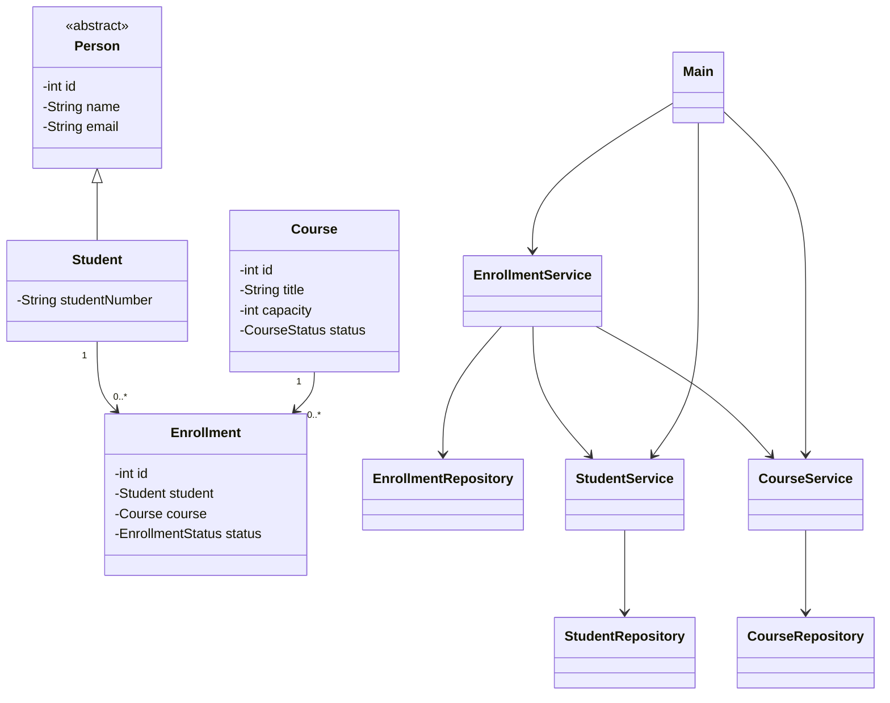

# LearnTrack

LearnTrack is a Core Java console application for managing students, courses, and enrollments. Records are stored in memory and reset when the application exits.

## Requirements

- JDK 8 or newer

## Compile and run

From the repository root:

```sh
mkdir -p out
javac -d out src/com/airtribe/learntrack/Main.java
java -cp out com.airtribe.learntrack.Main
```

On Windows, create the output folder with `New-Item -ItemType Directory -Force out` and use the same `javac` and `java` commands.

## Features

- Add and list students with validated names and email addresses.
- Add and list courses with a capacity.
- Enroll students, block duplicate enrollments, and enforce course capacity.
- List enrollments and withdraw an enrollment.
- Display helpful messages for invalid input and unknown IDs.

## Class diagram

The application keeps its related model, repository, and service classes as static nested classes in `Main.java`.



## Project layout

```text
src/com/airtribe/learntrack/Main.java
```

The project uses in-memory storage to keep the example dependency-free and easy to run. Data is not saved between runs.
